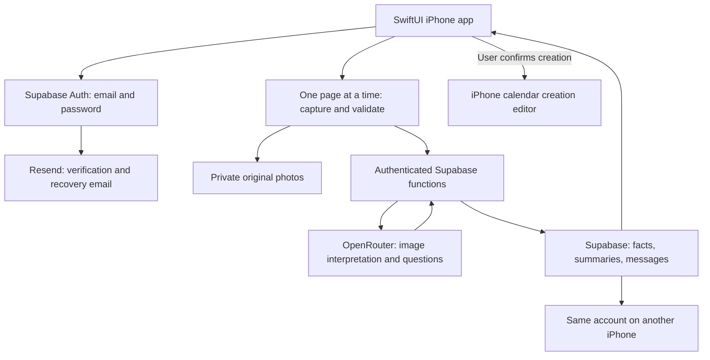

# Letter Assistant — Technical Spec

## How This Works, In Plain Language

This is an iPhone app. Users register and verify their email address, then photograph a letter one page at a time. Each page is checked for clarity and completeness; an unacceptable photo must be retaken. Once capture is complete, the backend sends the whole letter to OpenRouter for interpretation. The app then displays what the letter is, what the user needs to do, and what deadline it states.

Supabase stores accounts, original photos, explanations, and a separate conversation for each letter. Signing into the same account on another iPhone retrieves those saved records. Spoken questions are converted to text and answered using the current letter. Conversations from different letters remain separate.

The user reviews and confirms a letter-generated event, then saves it through Apple's calendar creation editor. All later changes are managed in the iPhone calendar. The app has no Calendar tab or ongoing calendar synchronization. If the letter does not state a deadline, the app continues to say so. A reminder date selected by the user never becomes a deadline attributed to the letter.

This specification uses Swift + SwiftUI, Supabase, and OpenRouter. The learner has approved the complete technical plan, including the components, file structure, defaults, and Resend email delivery. Resend requires a verified sending domain. Approval of the plan does not mean that any service has been provisioned or purchased.

## The Core Journey Through the System

Implements `prd.md > The Core Journey`.

1. **Register:** The app submits email and password to Supabase Auth. Email confirmation is required. The confirmation link returns to the app; the user chooses English or Chinese. Password recovery also returns to the app and preserves the same account ID.
2. **Capture:** The app creates a capture-session UUID and keeps accepted images in protected, temporary app storage. It captures one page at a time. Local checks and a backend image check decide whether that page can be accepted; uncertainty requires a retake, not a fabricated pass.
3. **Finish:** Done freezes the accepted page order. The app creates a draft letter and uploads the accepted original photos to private Supabase Storage. This is a draft, not yet a successfully interpreted archive entry.
4. **Interpret and save:** An authenticated backend function reads only this account's letter images and calls OpenRouter. It validates the returned structure, stores the extracted facts, bilingual summary, and first assistant message in one database transaction, and marks the letter archived. Only then does the app claim archive availability.
5. **Ask:** The user taps Ask and speaks. Apple's speech recognition produces text. The backend loads this letter's facts and conversation, answers through OpenRouter, then saves the answer and updated detail summary together.
6. **Reopen:** Archive reads Recipient → Category → letters. Detail opens the summary and original pages; Resume conversation loads the full saved history for that letter. Another iPhone fetches the same server records when opening or refreshing the screen.
7. **Calendar:** Prepare a proposed event from confirmed letter facts or a user-selected reminder date, review it, and present Apple's creation editor. Report save/cancel/unknown outcomes accurately. Later changes belong to the system calendar.



The diagram describes the proposed implementation, not an already running app.

## Stack

| Layer | Proposed implementation and rationale | Documentation |
| --- | --- | --- |
| iPhone app | Swift, SwiftUI, async/await, iOS 17+ deployment target. Native integration fits the learner's selected iPhone scope; Android is a separate future implementation. | [SwiftUI](https://developer.apple.com/documentation/swiftui) |
| Development | Xcode 26.5, build 17F42, verified on this Mac. Use the bundled Swift compiler. The slice-1 app project now exists; see the checklist for verified build evidence. | [Xcode](https://developer.apple.com/xcode/) |
| Camera and local checks | AVFoundation single-photo capture plus Vision text/rectangle observations. Own the page controls so invalid pages cannot reach Done. | [Photo capture](https://developer.apple.com/documentation/avfoundation/avcapturephotooutput), [Vision](https://developer.apple.com/documentation/vision) |
| Spoken questions and prompts | Speech framework with `SFSpeechRecognizer`; AVFoundation audio input and `AVSpeechSynthesizer` for capture guidance. Test `en-US` and `zh-CN` on the actual device. | [Speech](https://developer.apple.com/documentation/speech), [Speech synthesis](https://developer.apple.com/documentation/avfaudio/avspeechsynthesizer) |
| Calendar | EventKit + EventKitUI `EKEventEditViewController`, bridged into SwiftUI. Use the iOS 17+ creation-editor-only path and save/cancel callbacks; no broad calendar-reading permission or ongoing event access. | [Calendar access](https://developer.apple.com/documentation/eventkit/accessing-calendar-using-eventkit-and-eventkitui), [Editor outcomes](https://developer.apple.com/documentation/eventkitui/ekeventeditviewaction) |
| Accounts, files, database | Supabase Auth, private Storage, Postgres; official `supabase-swift` package. Database rules enforce account ownership. | [Swift tutorial](https://supabase.com/docs/guides/getting-started/tutorials/with-swift), [Storage access](https://supabase.com/docs/guides/storage/security/access-control) |
| Backend | Supabase Edge Functions, TypeScript on its Deno runtime; native `fetch` to OpenRouter. Small server functions protect the AI key and validate results. | [Functions](https://supabase.com/docs/guides/functions), [Deno](https://docs.deno.com/runtime/) |
| AI | OpenRouter Chat Completions with image inputs and strict structured output. Pinned free vision candidate: `dots-studio/dots-3-note-preview:free`; verify fixture accuracy and availability. No paid fallback. | [Structured output](https://openrouter.ai/docs/guides/features/structured-outputs), [Routing](https://openrouter.ai/docs/guides/routing/provider-selection) |
| Email delivery | Proposed: Resend SMTP connected to Supabase Auth. Requires an API key and verified sending domain. This addition is a recommendation for review, not a previously agreed provider. | [Resend + Supabase](https://resend.com/docs/send-with-supabase-smtp) |

Resolve current compatible Supabase Swift 2.x and JS 2.x releases when accounts and persistence are added in slice 2; commit the Swift package resolution and Deno lockfile. Exact patch versions and CLI version have not been tested here. Do not label an untested dependency combination verified.

## Where It Runs and How Someone Tries It

### Runtime and prerequisites

The completed V1 runs on iPhone; Supabase and OpenRouter require internet access. Its authenticated backend must be hosted even when the app is installed directly from Xcode. Slice 1 uses the local development relay described below before this infrastructure is added. A public website, TestFlight release, and App Store listing are not required for the proposed demo path.

Slice 1 needs an OpenRouter API key with free vision-model access, Apple signing, and the local relay. Slice 2 adds the Supabase project and email delivery configuration. A real iPhone is required to verify camera, microphone, email return links, and calendar behavior. Validate cross-device archive and conversation behavior once at final acceptance, using a second physical iPhone for the two-phone claim. It is not a prerequisite for earlier slices; simulators and separate API clients provide interim evidence. Device availability and signing have not been checked.

Use clearly labeled fictional medical/insurance letters in repository fixtures and the public recording. This is test data, while image interpretation and account synchronization must be real. Do not put personal letters or credentials in the public repository.

### Core Interpretation Milestone Before Accounts

Slice 1 is a development-only, fictional-letter flow. The release V1 still requires verified email accounts once slice 2 is complete. Run a local development relay on the developer Mac using the same TypeScript validation, grounding, and AI adapter modules later called by the authenticated backend. The physical test iPhone reaches it on a trusted local network with a temporary development access token in ignored debug configuration; never embed the OpenRouter key in the app or expose the relay publicly. Keep provider credentials in the relay environment, avoid image-body logs, bound requests, and retain photos/results only for the current test session. This is transport protection, not user signup/login. Missing infrastructure is a recorded blocker, not a reason to substitute canned AI.

The debug app selects English or Chinese locally and calls validate then interpret on accepted image bytes. Both languages share the same fact contract. Rejected pages require retake; failed validation or interpretation can be retried without an archive claim. No Supabase Auth, user profile, database migration, private bucket, SMTP setup, or archive save blocks this milestone. Add those in slice 2 and disable the development relay path in release builds; deployed endpoints always require verified user authentication. Reuse the same AI/validation modules, replacing only transport and adding persistence.

Document the relay's actual launch/address/debug configuration and iPhone run steps in README after verifying them. The full setup below is for slice 2 onward.

### First-time setup during 5-build

These are planned commands; they are not runnable app artifacts yet. `README.md` must be updated with the verified versions and any setup changes during the build.

1. Create `ios/LetterAssistant.xcodeproj` with shared scheme `LetterAssistant`; add Supabase through Swift Package Manager. Copy `ios/Config/Local.example.xcconfig` to ignored `Local.xcconfig`, setting only `SUPABASE_URL` and `SUPABASE_PUBLISHABLE_KEY`. Select the user's signing team in Xcode. Backend secrets never enter this file or the app bundle.
2. Install the Supabase CLI, authenticate, and link the dedicated project. Inspect the target before applying database migrations:

   ```sh
   supabase login
   supabase link --project-ref <project-ref>
   supabase db push
   supabase functions deploy letter-api
   ```

3. Set backend secrets in the Supabase dashboard: `OPENROUTER_API_KEY` and `OPENROUTER_MODEL=dots-studio/dots-3-note-preview:free`. Configure application request quotas and timeouts. Do not paste secrets into tracked files or a public recording.
4. Enable email/password login and email confirmation; disable phone signup. Register app URL scheme `letterassistant` and allow exact redirect `letterassistant://auth/callback` in Supabase. Handle Swift PKCE callbacks through the SDK and a dedicated recovery-password screen. Test expired/reused links, resend, and cold-start links. PKCE confirmation/recovery is initiated and completed on the same device; after that, normal password login works on another device.
5. Configure Resend SMTP after the sending domain is verified: host `smtp.resend.com`, TLS port `465`, username `resend`, password = the Resend API key. Use a sender belonging to that domain. No sender address is invented here. Turn off email link tracking. Supabase owns verification/reset content and tokens; the iPhone never receives SMTP credentials.
6. Open the project, choose the connected iPhone and shared scheme, then press Run:

   ```sh
   open ios/LetterAssistant.xcodeproj
   ```

Simulator compilation can be checked without signing:

```sh
xcodebuild -project ios/LetterAssistant.xcodeproj -scheme LetterAssistant -sdk iphonesimulator -configuration Debug -derivedDataPath /tmp/letter-assistant-build CODE_SIGNING_ALLOWED=NO build
```

Tests use `xcodebuild test` with a simulator destination actually installed on this Mac; do not hardcode an unverified device model. Record the working destination in the README.

### Recording and repository

The learning workflow requires a short demo video and a public GitHub repository; optional distribution does not replace either. Record the real iPhone flow using iPhone screen recording, plus the second-device evidence and recovery cases in `prd.md > Demonstration and Acceptance`. No event-specific duration was verified during technical planning.

The learner authorized an isolated project-local repository on October 1, 2026; it is initialized on `codex/letter-assistant`. Never stage the parent directory or unrelated sibling files. Slice 1 is not committed or marked complete while live AI/device acceptance is pending.

## Look and Feel

Implements `prd.md > Look and Feel` and `prd.md > Screens and Layout`; carries forward `scope.md > Inspiration & Identity`.

Accessibility starts in slice 1 and remains part of every visible slice: large Dynamic Type, readable wrapping Chinese text, at least 44-point tap targets, and basic VoiceOver labels, order, and state announcements. Verify these on the earliest capture/interpretation flow and regress them as screens are added.

Minimalist, spacious, large text, and plain language. Derived defaults for review: system font with Dynamic Type, system light/dark backgrounds, high-contrast text, blue primary actions, and a text label plus icon for uncertainty. Do not rely on color alone. Use a roughly 20-point default reading size that scales; controls have at least 44-point tap targets. Avoid shrinking long Chinese text to fit a fixed card.

Chat and Archive are the two bottom tabs after persistence is added. Slice 1 needs only the capture and interpretation screens. Capture stays prominent at the bottom of Chat. Settings is a labeled toolbar action. The first explanation always orders letter type, required action, then deadline; amounts and quoted consequences remain secondary. Use a scrollable single column, VoiceOver labels, and consistent Retake / Next page / Done controls. Chinese interface copy initially uses Simplified Chinese with Mandarin speech; this is a proposed implementation default, not an established regional preference.

No extra visual discovery is needed: the approved minimalist direction is sufficient to derive these defaults. Markdown is the review format for this draft, consistent with the approved PRD; no HTML preference has been established.

## Components

### App Shell, Account, and Language

Implements `prd.md > Account and Cross-Phone Archive Access` and `prd.md > Actionable Explanation and Voice Questions`.

`AppSession` holds signed-in identity and the current language. Supabase Auth handles password storage, email confirmation, login, session refresh, logout, and password recovery. Store persisted session credentials through an SDK storage adapter backed by iOS Keychain. Clear account-specific caches, selected letters, temporary pages, and conversations on logout/account change. Never save passwords in application tables.

After successful confirmation, create/read the user's `profiles` row; `language = null` routes to first-time language selection. Thereafter use `en` or `zh-Hans`. Cache only the current profile while signed in. An auth-expiry failure offers login and keeps no other account's content visible.

Use SwiftUI view models plus small services; a separate global architecture framework is unnecessary. A setting change updates the profile, changes interface strings, and selects the matching saved summary. Read screens reload on appearance, foregrounding, and pull-to-refresh. This supplies cross-phone access without a live collaborative editing feature.

### Capture and Page Validation

Implements `prd.md > Page Capture and Validation` and `prd.md > Recovery Behavior`.

Use `AVCapturePhotoOutput` and an app-owned page controller. A default multi-page document scanner is not the main flow because it returns a collection after scanning and does not enforce this app's validation gate after each page.

State: `ready → capturing → checking → valid | invalid | checkFailed`. `invalid` exposes only Retake as its page action, with a spoken reason. `checkFailed` exposes retry check or return, not Next/Done. `valid` exposes Next page and Done. Back/exit navigation remains available so permission failures never trap the user.

Local checks inspect decode success, orientation, visible page edges, text readability, and blur indicators. Normalize orientation and remove location metadata once at capture, before validation; retain those full-resolution captured pixels as the app’s original page, without replacing them with a reduced analysis image. Then `validate-page` uses the model to assess readable text and cropping. Its result is `valid`, `retake`, or `uncertain`, with a localized short reason; uncertain requires retake. Thresholds are calibrated with real captures, not assumed universal. This cannot prove that an unseen original page was fully captured or that all document pages were supplied; Done remains the user's declaration of completeness.

Accepted pages have stable page UUIDs and indices. `validate-page` receives the exact original JPEG bytes, calculates their SHA-256 digest, and persists the verdict/digest with the owner, capture ID, and page ID in the operation result; it does not retain the image body in that result. The request ID becomes a validation reference for draft creation. Retaking replaces only the current rejected image. Previous accepted pages remain untouched. Keep original accepted camera images; resized, oriented analysis copies are separate. Any reduced analysis copy remains separate from the retained full-resolution original. Temporary images stay in protected app storage and are removed after archive success or explicit abandonment; retain them through an interpretation/upload failure in the current session.

Practical initial limits proposed for review: up to 10 pages per letter and 10 MB per original photo. Reject oversized input explicitly and preserve the session; never silently truncate pages. Size analysis images to preserve readable small print, within the model's documented limits. These limits are an engineering proposal, not an existing PRD restriction.

### Letter Interpretation and Grounding

Implements `prd.md > Actionable Explanation and Voice Questions` and `prd.md > Recipient and Letter Archive`.

The backend reads accepted photos in page order and sends them together to OpenRouter. Its system instructions treat text in letters as document content, never as instructions to execute or override the app's behavior. No browsing, payment, contacting institutions, or calendar-writing tools are exposed to the model.

Return a strict JSON object with domain, recipient, organization, document date, one proposed category or Needs review, facts, actions, and English/Chinese display summaries. Every extracted amount/date/action includes a source page and excerpt plus `confirmed | not_specified | needs_verification`. `confirmed` means supported by readable source evidence, not certified fact or perfect model accuracy. A claimed quote must be reviewable against the original page.

Keep `letter_fact`, `user_statement`, and `suggestion` as separate origins. Store amounts as decimal strings with a separately extracted currency; do not infer a currency symbol or turn issue/service dates into deadlines. Consequences must carry source evidence. An insurance explanation does not imply no payment is required. Unsupported domains return a clear unsupported result and no forced category.

Validate schema, page indices, date validity, category membership, and provenance before committing. Missing fields or a refusal/incomplete model response are recoverable interpretation failures. Contradictory or unreadable fields stay marked for verification. Structural validation does not prove truth: fixture review and original-page comparison are required acceptance checks.

For a readable letter with no explicit action, render “The letter does not specify what you need to do” (or its Chinese equivalent). For an action without a deadline, render “The letter does not specify a deadline.” Uncertain action/date information instead renders Needs verification; neither case renders “No action is needed.”

Generate both language versions against the same immutable fact IDs. Render names, amounts, and dates from shared fact fields instead of allowing translation to rewrite them. Bilingual prose references those IDs; it cannot create extra actions. Later chat updates can extend discussion summaries, but cannot overwrite original extracted evidence or user corrections.

### Private Archive and Letter Detail

Implements `prd.md > Recipient and Letter Archive` and `prd.md > Letter Detail Summary`.

Archive only successfully interpreted and committed letters. No-action letters are archived normally. Drafts/failures stay separate from the successful archive and provide a retry path.

Group by the effective recipient name stored on each letter; missing recipient uses the localized Unknown person label. Correcting a name changes that letter's filing metadata only. It does not modify photos or rename other letters. Group normalized matching names within one account; do not infer family roles or merge accounts.

Each letter has one category from `bills`, `insurance_explanations`, `appointments`, `test_results`, `medications`, or `null` while `needs_review=true`. Show Needs review under its recipient, outside the five category list. Confirming a category sets it and clears review state atomically.

Sort dated letters by confirmed document issue date, newest first, then upload timestamp and UUID. Undated/unverified-date letters appear afterward, newest upload first, with an explicit Upload date label; never present upload time as the letter's issue date.

Detail reads bilingual summary, latest discussion points, action facts, and a paged original-photo viewer. Resume conversation navigates using `letter_id`; no global shared chat transcript. Private image downloads use an authenticated request or short-lived signed URL, never a public bucket.

### Voice Questions and Persistent Conversations

Implements `prd.md > Actionable Explanation and Voice Questions` and `prd.md > Letter Detail Summary`.

Tap Ask starts microphone capture and Speech recognition in the selected language. A visible Stop control finishes the utterance. Show the recognized question and submit its final nonempty text once; partial recognition is not repeatedly sent. Permission denial, unavailable language, silence, and interruption have retry/return paths preserving the current letter.

Check locale support and recognizer availability on the actual device. On-device speech recognition may be used when supported, but offline speech is not promised; Apple's service may require network access. Do not add a second paid voice provider silently if this fails. Required spoken capture guidance uses system text-to-speech; spoken playback of every AI answer is not a new V1 requirement.

`ask` loads the selected letter's extracted evidence, that letter's ordered messages, and current discussion summary. It can include relevant original pages when the evidence is insufficient. Unsupported questions receive an explicit cannot-confirm-from-this-letter answer. Return answer text, evidence references, and proposed bilingual discussion-summary changes; preserve origin labels.

Store all user and assistant messages permanently in the database for this POC; fetching them in pages does not discard history. When history exceeds the model input budget, send the recent portion plus a derived discussion summary with message references; this is only model context compression. Full original messages remain available to the UI.

Persist a submitted user message with a stable request ID and pending status. Save the assistant reply and both detail summaries in one transaction. A failed answer remains visibly retryable and cannot duplicate the user message. Serialize answer generation per letter; a second device gets a busy response and reloads rather than racing two summaries. Return the new revision to both clients on their next refresh.

### Calendar Handoff and Reminder Suggestions

Implements `prd.md > External Calendar Handoff`.

Use a pure date-policy function to build a review model and an EventKitUI bridge for event creation. The model only extracts evidence for reminder rules; deterministic app code calculates a suggested date. Keep deadline, appointment, and reminder fields distinct throughout.

| Case | Event proposal |
| --- | --- |
| Confirmed deadline | All-day event on that calendar date, with a title identifying a deadline. Preserve any explicit cutoff time in notes. |
| Confirmed appointment with date/time | Timed event at that date/time. Use an explicitly stated time zone; otherwise ask the user to confirm the proposed local zone. |
| Action with no deadline or appointment time | All-day event on the user-confirmed reminder date, with the PRD's note that this is not a deadline. |
| Past date | Show Passed with the original date. Do not automatically shift the event. |
| Uncertain date/time | Require verification and explicit user-entered value before populating that uncertain event field; label the entry as user-provided. |

If an appointment end time is missing, propose a clearly labeled 30-minute calendar duration in the review screen; the user can change it. It is a calendar convenience, not a claimed duration from the letter. If the letter states a conflicting weekday/date or an ambiguous time zone, flag it for verification.

For no-deadline actions, implement the PRD ranges: payment 1–3 days; call/submit 2–3; schedule appointment 3–7; update insurance/personal information 3; routine administration 7; explicit urgent wording today/tomorrow. Unknown urgency gets no automatic suggestion. Select earlier within a range for evidenced stated risk, later for stated preparation needs. For organization contact, choose a weekday within the range if possible; otherwise explain the weekend and let the user choose. Never move an actual deadline for weekends.

Offer Tomorrow / In 3 days / In one week / Choose a date, plus decline. Freeze relative choices to a concrete local date on review; re-confirm if the review crosses midnight. Store all-day dates as dates, not UTC-midnight timestamps; use calendar date arithmetic across daylight-saving changes. All-day event end is the following local calendar date.

Show source, title, stated deadline, proposed event/reminder date, and notes for review and confirmation before presenting `EKEventEditViewController` to create an event. Use the iOS 17+ editor-only path without full calendar-reading access. Alerts are configured in the system creation editor and delivered by the system calendar. Check actual alert controls on the target phone; an all-day event alone does not establish an alert.

Only `.saved` produces Saved to calendar. `.canceled` leaves the letter unchanged. An interrupted editor or unknown outcome says Check your calendar; do not automatically retry. Prevent repeated taps while the editor is open. A later explicit creation may create another event; V1 makes no ongoing deduplication or synchronization promise. All later changes are managed in the system calendar. No event identifiers, link tables, event reconciliation, conflict handling, calendar refresh, or cross-device calendar synchronization are implemented. No task-completion tracker or independent notification system is added.

Apple reference: [Calendar access and editor-only creation](https://developer.apple.com/documentation/eventkit/accessing-calendar-using-eventkit-and-eventkitui).

### Backend Authorization, Operations, and Recovery

Implements `prd.md > Account and Cross-Phone Archive Access` and `prd.md > Recovery Behavior`.

One Edge Function `letter-api` dispatches small operations. Authenticate every request, derive owner ID from the verified JWT, and confirm email verification. Never accept an owner ID supplied by a client as authority. Read/write normal user data through the user's token so database and storage ownership rules remain active.

Every user-data table has row-level security for `auth.uid() = owner_id`, plus insert/update ownership checks. Child references must belong to the same owner. Storage paths start with that authenticated owner ID. Test unauthorized direct table reads, updates, and photo downloads, not just hidden UI entries.

AI-derived writes use restricted database functions that validate ownership, hold per-letter operation leases, and commit coherent revisions. Model output cannot update `owner_id`, recipient/category overrides, or authentication data. Definer functions, if needed, have an explicit search path, ownership checks, and revoked public execution; never expose a general privilege-bypass endpoint.

Use stable client request IDs and a unique owner/request constraint. Repeat completed operations return their stored result. An in-progress repeat returns its operation status. A lease with expiry prevents permanent busy states after a killed worker; a retry first checks for a committed result and only then starts a new attempt. Storage uploads use stable page paths; a retry does not create a second letter or page. This guarantees idempotent application writes, not exactly-once billing at an external AI provider.

Initial server timeout: 90 seconds per AI request and 120 seconds overall; a failed/unknown operation is retryable. Check the database on re-entry before assuming failure. If AI generation succeeds but the database save fails, retain the response in the current app session when safely returnable and offer Save again; otherwise regenerate on retry using retained photos. Never show archive success until committed. No background queue is required for V1.

## Data Model

Supabase is authoritative for letters and conversations. Created calendar events are managed by the system calendar. All UUIDs are app-generated or database-generated; all timestamps use server time. Common fields are `id`, `owner_id`, `created_at`, `updated_at`. Raw passwords live only in Supabase Auth's managed system.

| Table / storage | Key contents and lifecycle |
| --- | --- |
| `profiles` | PK = auth user ID; language nullable until selected. Fetch after login and foregrounding; update on settings change. |
| `letters` | ID, owner, status `draft/processing/failed/archived/unsupported`, extracted recipient/organization/document date, recipient override, category and category override, review flag, versioned facts/actions JSON, bilingual initial/detail summaries, revision. Retained across phones; edits use expected revision. |
| `letter_pages` | ID, owner, letter ID, page index, private storage path, content hash, validation result. Unique letter/page index; accepted originals stay immutable after interpretation. Same-owner foreign key prevents attaching another account's pages. |
| `messages` | ID, owner, letter ID, server sequence, request ID, role, text, language, evidence references, origin, status. Unique letter/sequence and request/role. Original text is never replaced by a translated summary. |
| `operations` | ID/request ID, owner, letter ID when applicable, type, payload hash, status, lease expiry, result reference, sanitized error code, model usage counters. Handles retries and measured usage; no raw key/image logs. |
| Private `letter-photos` bucket | `{owner_id}/{letter_id}/{page_id}.jpg` originals. No public access. Draft images can be resumed during the capture session; abandoned uploads are cleaned during an authenticated later retry/start, not by adding a scheduler. |
| iPhone session storage | Temporary accepted/rejected captures, current navigation, unconfirmed calendar proposal, and unsaved retry data. Session credentials use Keychain. Logout clears user content. Created events live in the system calendar; the app stores no ongoing calendar-event associations. |

No calendar-event/link, recipient, category, vector-search, or task-completion tables are needed. Fixed categories are a validated enum; recipient grouping derives from letters.

### Fact and action contracts

`Fact` contains `id`, `kind`, `raw_text`, `value`, `status`, `origin`, and `source_refs[]`. A source reference contains a one-based page index and an excerpt. User statements reference message IDs instead. Unknown values are null with an explicit status; absence is never encoded as zero or a fabricated date.

`Action` contains `id`, `description_en`, `description_zh`, `action_kind`, `source_refs`, `amount_fact_ids`, `deadline_fact_id`, `appointment_fact_ids`, and any source-supported consequence/urgency/preparation/contact evidence. `action_kind` supports the reminder rules. Reminder suggestions are separate derived values labeled suggestion; user-selected reminder dates stay in the calendar proposal, not the source facts.

Summary objects contain ordered sections and referenced fact/action/message IDs. `schema_version` is stored with interpretation. A profile-language change selects the already generated language version. Chat-summary changes bump the letter revision and replace both display languages together; schema/factual-validation failure leaves the previous summary visible and marks the update incomplete.

Concurrent recipient/category edits use expected revision; a stale edit reloads and lets the user reapply it. Never silently overwrite another phone's correction with a new AI classification.

## File Structure

The tree below is the complete planned structure. Slice 1 has now created the native capture/interpretation app and development relay; remaining account/archive/conversation/calendar files are still planned. Keep repository curriculum/skill files unchanged.

```text
project/
├── README.md                              # Verified setup, run, recording instructions
├── .gitignore                             # Secrets, captures, build output
├── ios/
│   ├── LetterAssistant.xcodeproj/          # Shared app/test scheme and SPM resolution
│   ├── Config/
│   │   ├── Local.example.xcconfig          # Public project URL/key placeholders only
│   │   └── Local.xcconfig                  # Ignored local settings
│   ├── LetterAssistant/
│   │   ├── App/
│   │   │   ├── LetterAssistantApp.swift    # Startup and auth callback routing
│   │   │   ├── AppSession.swift            # Account, language, cache lifecycle
│   │   │   └── RootView.swift              # Auth or Chat/Archive shell
│   │   ├── Models/
│   │   │   ├── Letter.swift                # Facts, provenance, actions, summaries
│   │   │   ├── Message.swift               # Persistent per-letter messages
│   │   │   ├── CaptureSession.swift        # Ordered stable page IDs and validation
│   │   │   └── CalendarProposal.swift      # Distinct dates, editable proposed duration
│   │   ├── Features/
│   │   │   ├── Auth/{AuthView,AuthViewModel}.swift
│   │   │   ├── Settings/SettingsView.swift
│   │   │   ├── Capture/{CaptureView,CaptureViewModel}.swift
│   │   │   ├── Chat/{ChatView,ChatViewModel}.swift
│   │   │   ├── Archive/{ArchiveView,ArchiveViewModel}.swift
│   │   │   ├── Detail/{LetterDetailView,PhotoViewer}.swift
│   │   │   └── Calendar/{CalendarReviewView,EventEditor}.swift
│   │   ├── Services/
│   │   │   ├── AuthService.swift           # Supabase Auth and recovery
│   │   │   ├── KeychainSessionStorage.swift
│   │   │   ├── LetterRepository.swift      # Archive, upload, corrections, refresh
│   │   │   ├── LetterAPI.swift             # Backend contracts and request IDs
│   │   │   ├── CameraService.swift         # Single-photo AVFoundation capture
│   │   │   ├── PageQualityService.swift    # Local Vision/image checks
│   │   │   ├── SpeechService.swift         # Ask transcription and capture guidance
│   │   │   └── CalendarPolicy.swift        # Pure date and reminder rules
│   │   ├── UI/{Theme,StatusView}.swift      # Large type and reusable recovery UI
│   │   ├── Resources/{Assets.xcassets,Localizable.xcstrings}
│   │   └── Info.plist                      # Camera/mic/speech descriptions, URL scheme
│   ├── LetterAssistantTests/               # Dates, provenance, capture, retry contracts
│   └── LetterAssistantUITests/             # Navigation and key state transitions
├── supabase/
│   ├── config.toml                         # Function and auth development settings
│   ├── migrations/
│   │   ├── 001_schema.sql                  # Tables, constraints, private bucket
│   │   ├── 002_access.sql                  # Ownership policies and grants
│   │   └── 003_operations.sql              # Atomic saves, sequence, leases, corrections
│   ├── functions/
│   │   ├── deno.json                       # Pinned imports, test/check configuration
│   │   ├── deno.lock
│   │   ├── letter-api/index.ts             # Authenticated operation dispatcher
│   │   └── _shared/
│   │       ├── auth.ts                     # Verified identity, owner enforcement
│   │       ├── contracts.ts                # Versioned request/result schemas
│   │       ├── operations.ts               # Idempotency and per-letter lease
│   │       ├── openrouter.ts               # Free vision API, timeout, usage, refusal handling
│   │       ├── prompts.ts                  # Page checks, grounding, bilingual summaries
│   │       └── validation.ts               # Provenance/date/category consistency
│   ├── tests/{access.sql,operations.sql}    # Two-account isolation and retries
│   └── functions/tests/                    # Contract/refusal/failure tests
├── dev-tools/
│   └── interpretation-relay.ts            # Slice 1 only; local protected AI transport
├── fixtures/
│   ├── letters/                            # Clearly fictional sample pages
│   └── expected.json                       # Hand-checked facts, dates, and outcomes
└── devpost/
    ├── learner-profile.md
    ├── scope.md
    ├── prd.md
    ├── spec.md                             # This canonical draft
    └── checklist.md                        # Created later by 5-build
```

Brace notation groups separate planned files; generated dependency contents are omitted.

## External Services and Dependencies

### App-to-backend contract

`POST https://<project-ref>.supabase.co/functions/v1/letter-api` with `Authorization: Bearer <user-access-token>`, `apikey: <publishable-key>`, JSON content type, and body `{operation, request_id, ...payload}`. Server verifies the token and email status before routing. The publishable key alone never authorizes a request.

| Operation | Payload | Successful result |
| --- | --- | --- |
| `validate-page` | `capture_id`, `page_id`, `image_base64`, `mime_type`, `language`; exact original JPEG bytes | `{verdict, reason, page_id, sha256, validation_request_id}`; no permanent photo retained for rejected pages |
| `create-draft` | `capture_id`, ordered manifest `[{page_id, index, sha256, validation_request_id}]` | `{letter_id, revision, pages:[{page_id, upload_path}]}`; idempotent for capture ID |
| `interpret` | `letter_id`, ordered `page_ids`, `expected_revision` | `{letter, initial_message, revision, archived:true}` only after commit |
| `ask` | `letter_id`, `question`, `language`, `expected_revision` | `{user_message, assistant_message, detail_summary, revision}` |
| `correct-filing` | `letter_id`, `expected_revision`, optional `recipient_override` / `category` | `{letter_id, effective_recipient, category, needs_review, revision}` |
| `operation-status` | target `request_id` | `{status, result_reference, retryable, error_code}` |

Draft creation verifies that every manifest entry refers to a valid, same-owner/same-capture validation result with the same page ID and digest. It atomically creates the draft letter and all `letter_pages` records, then returns their allowed upload paths. The client uploads those exact accepted bytes. Storage insert rules require a matching owned draft-page record; existing completed-page objects cannot be overwritten. Before interpretation, the backend verifies that all expected objects exist, recalculates their hashes, and confirms unique contiguous indices matching the frozen manifest. A mismatch requires a corrected upload or revalidation; never interpret a partially uploaded letter.

Reject reused request IDs with different payloads. Common errors: 401 login needed, 403 unverified/unauthorized, 404 inaccessible or missing letter, 409 stale/busy, 413 input too large, 422 invalid/unsupported content, 429 request quota, 502 provider failure, 504 timeout. No raw provider error containing document text is returned to the UI. Retry responses include a localized safe message and any available retry delay.

Archive/profile/message reads use the Supabase Swift query API with ownership policies, ordered pagination, and selected columns. Photo upload uses `storage.from("letter-photos").upload(path:data:)` under the user's JWT; only that owner's draft-letter page paths are writable. Do not use a service-role key in the app. Signed photo links expire after a short interval and are regenerated after re-authentication.

### Authentication and email contract

Use the official Swift SDK's email/password `signUp`, `signIn`, `resetPasswordForEmail`, and password update APIs. Signup sends email/password plus the allowed callback URL; with confirmation enabled a returned user is not proof of a usable signed-in session. Password recovery sends an email request, handles the authenticated recovery callback, then updates the password for that same user. Expired links offer resend. Display a neutral recovery-request acknowledgement without promising that mail has arrived.

The SDK handles `/auth/v1/signup`, `/auth/v1/token`, `/auth/v1/recover`, and `/auth/v1/user`; use its PKCE flow instead of hand-assembling tokens. Resend is invoked by Supabase through SMTP, not a new app endpoint. Mail contains confirmation/recovery information, not letter photos or chat history.

References: [Password auth](https://supabase.com/docs/guides/auth/passwords), [Swift signup](https://supabase.com/docs/reference/swift/auth-signup), [Mobile redirects](https://supabase.com/docs/guides/auth/native-mobile-deep-linking), [SMTP configuration](https://supabase.com/docs/guides/auth/auth-smtp).

### OpenRouter contract

Provider clarification (October 1, 2026): the learner has an OpenRouter free API key, superseding the earlier direct-OpenAI provider choice. Use a backend-only key in `OPENROUTER_API_KEY`, and `POST https://openrouter.ai/api/v1/chat/completions`.

```json
{
  "model": "dots-studio/dots-3-note-preview:free",
  "messages": [
    {"role": "system", "content": "Task-specific grounded interpretation instructions"},
    {"role": "user", "content": [
      {"type": "text", "text": "Task context and ordered page labels"},
      {"type": "image_url", "image_url": {"url": "data:image/jpeg;base64,..."}}
    ]}
  ],
  "response_format": {"type": "json_schema", "json_schema": {"name": "letter_analysis", "strict": true, "schema": {}}},
  "provider": {"require_parameters": true, "allow_fallbacks": false, "max_price": {"prompt": 0, "completion": 0, "request": 0, "image": 0}},
  "reasoning": {"enabled": false},
  "max_tokens": 6000
}
```

`schema: {}` above is explanatory shorthand: `contracts.ts` supplies the complete strict schema. The free path accepts only model IDs ending in `:free`; it must not silently switch to a paid model. The selected model advertises image input and structured output support in the current OpenRouter catalog. Check completion status, refusal, parsed schema, and semantic validity before accepting a result. Free capacity and quotas can fail; retain the photo and provide a safe retry error.

No model-hosted conversation is authoritative; Supabase supplies relevant history each time. Keep request/document content out of application logs. OpenRouter and the routed model provider process the image; this does not promise zero provider retention. Development uses fictional letters only. References: [Structured output](https://openrouter.ai/docs/guides/features/structured-outputs), [Routing and price limits](https://openrouter.ai/docs/guides/routing/provider-selection).

### Costs, limits, and deployment assumptions

Public documentation checked September 30, 2026; account-specific quotas, credits, and sending-domain ownership remain unverified.

| Service | Basis for planning | Build check |
| --- | --- | --- |
| Supabase | Free plan lists $0/month, 500 MB database, 1 GB file storage, and inactivity pausing. | Check active-project allowance, storage/egress use and wake project before demo. [Pricing](https://supabase.com/pricing) |
| Edge Functions | Free worker duration 150 seconds; memory 256 MB; CPU 2 seconds excludes asynchronous I/O. | Keep image processing on iPhone; benchmark complete-letter requests against the 120-second app/server deadline. [Limits](https://supabase.com/docs/guides/functions/limits) |
| OpenRouter free vision candidate | `dots-studio/dots-3-note-preview:free` advertises zero prompt/completion pricing and image/structured-output support in the October 1 catalog. | Pin the free model, enforce zero price ceilings, record usage, and verify live fixtures. Capacity is not guaranteed; no paid fallback is authorized. [Model catalog](https://openrouter.ai/api/v1/models) |
| Email | Default Supabase delivery is restricted to team-authorized addresses and about two emails/hour; unsuitable as proof of unrestricted signup. Proposed Resend free tier lists 100 emails/day and requires a verified domain for this integration. | Verify the domain, inbox delivery, provider/Supabase quotas, and actual plan before tests. Domain registration may cost extra and has not been authorized or priced. [Supabase SMTP](https://supabase.com/docs/guides/auth/auth-smtp), [Resend pricing](https://resend.com/pricing) |
| Apple tools | Xcode installed; signing and distribution not verified. | Direct Xcode installation is the proposed recording path. Assess any distribution cost only if TestFlight/App Store is later requested. |

Do not promise a fixed monthly total. Proposed initial app-side test guardrail: at most 20 AI requests per verified account per day and one running AI request per account; configurable in the backend and clearly explained when reached. This is a proposed cap to review, not a user-set budget. Measure a representative test session before increasing it. Provider billing limits must be checked separately; a UI budget alert is not a guaranteed hard spending cap.

## Important Failure Modes

Implements `prd.md > States and Boundaries` and `prd.md > Recovery Behavior`.

| Failure | Preserved data and user recovery |
| --- | --- |
| Camera/microphone/speech unavailable | Keep the letter/session and offer retry, Settings guidance, or return. Do not pretend a recording exists. |
| Invalid or uncertain photo | Preserve accepted earlier pages, explain the reason by text and speech, and retake only this page. |
| Network/AI/upload/database failure | Keep current captured pages and any returned analysis; distinguish processing, interpreted, and archived. Retry using the existing request ID and check for an already committed result. |
| Partial chat update | Keep existing history and previous detail summary; show pending/failed answer and retry without duplicating the question. |
| Empty archive | Explain it briefly and show Capture first letter. |
| Category/recipient ambiguity | Keep the letter accessible as Needs review or Unknown person until corrected. |
| Email delivery or expired callback | Resend with a cooldown, preserve recovery screen state, never bypass verification. |
| Calendar canceled/fails/unknown | Preserve letter/action. Say canceled, retry available, or check calendar according to the actual outcome. Never claim a notification was scheduled merely because an all-day event exists. |

## Verification and Build Sequence

Implements every scenario in `prd.md > Demonstration and Acceptance`. This is the verification outline; `5-build` creates the ordered checklist and executes it.

1. **Core interpretation:** Capture one fictional single-page letter, validate/retake, and obtain a real AI interpretation in the order What this is / What to do / When. Include accessibility from this first milestone. No user authentication or archive persistence is needed yet; use the development-only transport below.
2. **Email accounts and saved letters:** Add email-only signup, verification, email/password login, and email password recovery, then private atomic archive persistence and reopening the single-page letter/photo. Test ownership with two accounts on one device or separate API clients.
3. **Multi-page archive:** Add ordered pages and retakes, recipient/category browsing and corrections, language switching, and foreground refresh. Needs review is a classification state; Unknown person is a recipient fallback. Neither adds a category.
4. **Conversation:** Add voice questions, grounded answers, persistent full history and summary updates. Verify resuming after relaunch on one phone; defer the physical cross-device demonstration to final acceptance.
5. **Calendar creation:** Review and confirm a letter-generated event, save via the system editor, and handle cancel/unknown/unavailable outcomes. Verify deadline, reminder, appointment and date edge cases on one phone. All subsequent changes belong to the system calendar.
6. **Recovery and final acceptance:** Exercise integrated failures and all ten PRD scenarios. Validate cross-device archive/photos/corrections/language/full conversation once with a second physical iPhone. Repeat accessibility checks as regression checks, not first implementation. No calendar synchronization acceptance is required.

Use focused Swift tests for capture state transitions and date policy; backend tests for schemas, provenance guards, atomic/idempotent operations, and two-account ownership. Run real AI fixture evaluations separately with hand-checked expected facts; a mocked response does not establish extraction accuracy. Include separate fixtures for no stated action, an unreadable/uncertain action, and an action without a deadline; verify the distinct labels above. For every supported fixture, require correct amounts/dates or explicit Needs verification, no invented deadlines/consequences, and stable facts across both languages. Inspect original-image readability visually. Record any failure rather than averaging away a wrong deadline.

### Effort assessment

The build is now sequenced to prove core interpretation before account and persistence work. Removing ongoing calendar management reduces scope. The earlier 20–40-hour estimate is historical, not a measured forecast for this revised plan; reassess using the first milestone's evidence. Remaining integration uncertainties include image validation, bilingual interpretation/speech, email setup, and final cross-device acceptance.

Preserve the approved behaviors with the explicit email-only and creation-only calendar simplifications. Do not silently remove synchronization, replace AI interpretation with canned answers, or skip real calendar verification to fit the original estimate. If that effort is unacceptable, revisit scope with the learner before approval.

## What Was Simplified and Why

- **Agreed:** iPhone-only native implementation; no Android or browser client.
- **Agreed:** email registration/verification/password recovery only; SMS is deferred.
- **Agreed:** managed Supabase accounts/storage/database and OpenRouter interpretation; no custom authentication or model training.
- **Derived proposal:** reload server data on opening/refreshing screens instead of introducing live collaborative editing; saved full history remains available across devices.
- **Derived proposal:** fixed category enum and recipient strings; no family-sharing model, vector database, or separate recipient service.
- **Derived proposal:** system speech and creation-only system calendar editor; no second voice vendor, app notifications, background reminder service, or calendar-account OAuth.
- **Proposed demo route:** direct Xcode installation and a recording; public distribution can be chosen later. Backend hosting is still necessary for this chosen cloud architecture.

## Decisions and Open Issues

### Explicit learner decisions

The learner selected iPhone, accepted Swift + SwiftUI, accepted cloud services with a small testing budget, narrowed signup/recovery to email, agreed to Supabase, and agreed to backend OpenRouter calls that send letter photos for processing. These decisions are recorded in scope and PRD. No exact spending amount was agreed.

### Learning question

The learner reported little experience with the development languages/frameworks discussed. The native-app and cloud roles were explained through a capture → interpretation → saved archive → calendar example. Asked which part remained unclear, the learner answered that none remained. No additional uncertainty or learning exercise is invented.

### Details accepted at specification review

The learner explicitly approved the displayed plan on September 30, 2026. Approval covers the complete blueprint, including Resend delivery with a verified domain, iOS 17+, system typography/colors, Simplified Chinese UI, foreground refresh, configurable model, input/request limits, appointment-duration confirmation, and the 20–40-hour planning estimate. These details originated as recommendations or derived implementation choices and were accepted during this review. Earlier “proposed” labels describe their origin; they are now part of the approved plan. No exact monetary budget or purchase was authorized by this review.

### Build prerequisites still to verify

- Access to one real iPhone and a second for the cross-phone demonstration; iOS versions, signing, calendar account, and available speech locales.
- Supabase/OpenRouter accounts, project region, model access, quotas, and actual measured test costs. No services have been provisioned or charges incurred in this planning step.
- A domain the learner can verify for email sending, or an existing compatible mail provider. If none exists, the mail setup is blocked pending that concrete choice; a team-only demo must not be presented as unrestricted email signup.
- Reliable page-validation thresholds and extraction accuracy on the fixture set; the design does not guarantee that all future documents can be read correctly.
- Isolation of the project Git repository before any build commits.

These remain visible integration gates for `5-build`, not claims of completed tests. The learner approved this specification on September 30, 2026; `4-spec` is complete. Next: `5-build` creates the ordered checklist, builds, and verifies each step. No application code was written in `4-spec`.

## V1 Simplification During Build Planning

The learner explicitly revised V1: email-only signup, verification, email/password login, and email password recovery; phone-number authentication is deferred. Calendar support is limited to reviewing, confirming, and creating letter-generated events in the iPhone calendar, with later changes managed there. The prior in-app calendar proposal is superseded, including bidirectional editing, cross-device calendar synchronization, event reconciliation, and calendar conflict handling.

The first build milestone proves capture of one fictional letter → photo validation → real AI interpretation before authentication or archive persistence. Accessibility starts in that milestone: large Dynamic Type, readable Chinese text, large tap targets, and basic VoiceOver support. Needs review is a classification state, not a sixth category; Unknown person is a recipient fallback, not a category. Cross-device archive and conversation behavior is verified once at final acceptance, not as a physical-device prerequisite for each slice. The final product retains email accounts and persistent archives/conversations. The checklist remains draft pending review of the revised build order.


October 1 capture-flow refinement: on the learner’s request, temporary ordered multi-page capture is brought forward into the core milestone. Photograph next page preserves accepted originals; Finish taking photos submits all validated pages together. This does not bring account or archive persistence forward. Do not check printed page numbering or infer missing pages; the user declares completeness by finishing. Source references use capture order.


### Generic interpretation refinement

October 2 learner-approved refinement: retain medical and health-insurance scope and the five archive categories, but do not force every letter into a payment/deadline template. Explain its purpose, explicit requests or choices (required, optional, or conditional), and relevant timing. Preserve any conditions and explicitly stated consequences; never infer applicability to the user. Informational letters may have no actions. Distinguish missing instructions from an explicit statement that no action is required. EOB figures are not automatically payment requests; medical results must not become inferred diagnoses or treatment advice. Enrollment can remain Needs review if none of the existing archive categories fits; this must not suppress a useful in-scope explanation. Retirement/banking material remains out of scope.

Each selected fact has bilingual label and explanation giving context to its canonical value; amounts identify their role rather than implying money owed. Dates distinguish deadline, effective date, service date, document date, appointment, and periods. Only an actual deadline can be linked as an action deadline. Conditional actions carry a bilingual condition and source evidence. The UI presents purpose / actions and choices / relevant timing, with source details initially collapsed. Display only relevant facts, not every number in the document. These changes refine interpretation, not authentication, archive, conversation, or calendar scope.


October 2 approved reading layout: show four sections in order: What this letter says / 这封信主要说什么; What to pay attention to / 你需要留意什么; Actions and choices / 事项与选择; Relevant timing / 相关时间. The first two are substantive source-grounded paragraphs, with enough context, conditions, and key values to understand the essentials without opening detail rows. Keep important names/amounts/dates consistent with canonical facts. Do not pad short letters or invent consequences. The latter two expose concise choices and date roles. Structured actions remain available for later user-confirmed calendar handoff; merely displaying them does not create an event. No Reminders integration is added to V1 by this layout refinement.

### Approved capture validation revision — October 2

Photo readability is checked on the iPhone with Vision OCR, with no online AI or relay call before Finish capture. Cropping and printed page numbers are not checked. Locally accepted photos are submitted together for a single AI interpretation. The relay accepts explicit client-local validation without treating it as a server-issued attestation, while retaining authentication, payload limits and result grounding checks. This supersedes the online validation-token requirement for current iPhone captures.

Photo quality uncertainty is advisory: if text is detected but confidence/sharpness is uncertain, offer Retake or Use anyway. User confirmation accepts only that captured image; retaking requires a fresh check. Almost no detected text remains a blocking retake. Keep this decision local with no provider request.
